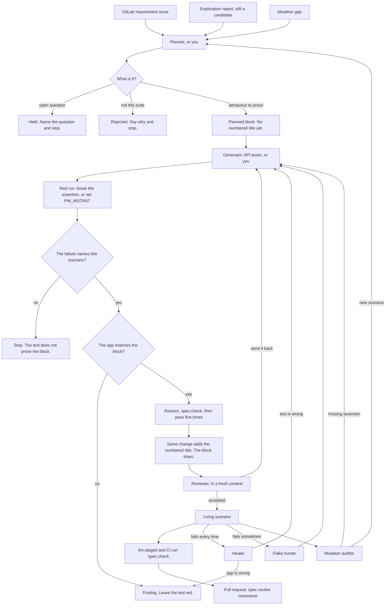

# Spec guide for new joiners

How acceptance behaviour is specified, turned into tests, and kept honest in this
suite. Read this once; after that the templates and `npm run spec:check` carry you.

## What "spec-driven" means here

1. **The spec comes first.** Behaviour a visitor can observe is written down in
   `specs/features/<feature>.md` before (or with) the Playwright test. Product
   internals are not here; they live in `bjjeire-java/specs/`.
2. **The spec is the index of the tests.** The numbered titles in a feature spec are
   the test titles, character for character. If they differ, `npm run spec:check`
   fails, locally (lint-staged) and in CI.
3. **Agents read and write the same file.** The planner adds a `####` block. The
   generator or API tester adds the test and the numbered title together. The
   reviewer checks the diff against the block. The healer reads the block before
   deciding whether the app or the test is wrong. Writing a good spec block is the
   highest-leverage thing you can do for them.

## End to end

`/cover-feature <feature>` runs the middle: plan, then one scenario at a time,
then review. A numbered title is added only in the change that adds its test.



Held and Rejected are how a proposal stops. The block stays after the test exists, so the healer and the reviewer can read it.

A red run that still passes means the test does not prove the block. When the app disagrees with the block, the test stays red and the difference is a finding. `spec:check` runs again in the green step, before review.

Agents do not commit. A `playwright-fix` dispatch is the healer again, later, from CI evidence, and it may repair a test only. Scenarios that predate a block are grandfathered. New ones get a block first.

## The map

| Path                              | What it is                                                          |
| --------------------------------- | ------------------------------------------------------------------- |
| `specs/features/<feature>.md`     | The living spec: scenarios, constraints, planned blocks             |
| `specs/templates/`                | Templates to copy. The filled block is in `templates/README.md`     |
| `specs/exploration/`              | Dated exploratory session reports (evidence, not the spec)          |
| `specs/mutation/`                 | Dated mutation audits: which wrong data the tests miss              |
| GitLab `bjjeire/requirements`     | Requirement issues (`#142`) and epics (`&<n>`). CI stays on GitHub. |
| `.specify/memory/constitution.md` | The principles; short, read it                                      |
| `scripts/spec-check.mjs`          | The drift check behind `npm run spec:check`                         |

## Anatomy of a feature spec

The section order is the template: header, overview, `## Coverage`, `## Scenarios`,
`## Constraints`, `## Planned`, then Held, Rejected and Findings. A planned block
has `Covers`, `Oracle`, `Steps`, `Expected results`, `Why` and one `Test design`
line. The filled example is in [`specs/templates/README.md`](../specs/templates/README.md).

The `**Slice**:` line is what `spec:check` uses to find the tests: the first backticked
`tests/...` path. Every `*.spec.ts` under `tests/` must be claimed by one spec.

## Before you add a scenario

Name what you are assuming before you write the block. The ones that change the
scenario are the browser project, the seeded record, the GitLab issue, and whether
the app repo already owns the rule. A guess goes in `## Held` with the question, and
you stop.

A vague request is not a scenario yet. "Make search better" becomes one requirement
issue, one oracle, and one Then: the visitor searches for part of a seeded name and
only that record is listed. If you cannot name what the visitor would notice, there
is nothing to plan.

Skip a new block when the spec already says the thing:

- A typo in a step title is an edit to that line.
- A behaviour that is already a numbered scenario needs no second block.
- A rule the Coverage table marks `App repo` is not re-proved here.

| Temptation                                                           | What to do                                                                                     |
| -------------------------------------------------------------------- | ---------------------------------------------------------------------------------------------- |
| "The app already does this, so I'll copy it and fix the spec later." | The block is the requirement. If the app disagrees, the test stays red and you file a finding. |
| "This is too small to specify."                                      | A two-line block is enough: one When, one Then.                                                |
| "I'll add the numbered title now and the test in a follow-up."       | The title is added in the same change as the test.                                             |

## Adding a scenario by hand

1. Open the feature spec. Check `## Rejected` and `## Held` so you do not re-propose
   something already decided.
2. Find the requirement issue in the GitLab project named on the spec's
   **Requirements** line. Cite that issue's id (`#142`). If none fits, write
   `Covers: none` and name the risk or the exploration finding.
3. Write the `####` block under `## Planned` in the template shape: `Covers`, `Oracle`,
   `Steps`, `Expected results`, one-sentence `Why`, and `Test design`.
4. Write the test with the same title and the same step wording. Watch it fail first
   (against missing behaviour, a mutant with `PW_MUTANT=…`, or a deliberately broken
   assertion), then make it pass, then run it with `--repeat-each=5`.
5. Add the title to the numbered list, with its tags and the issue id, in that same change.
6. Run `npm run spec:check`, then ask `@agent-playwright-test-reviewer` to review the diff.

Or let the agents do steps 3 to 6: `/cover-feature <feature>` runs planner, generator or
API tester, and reviewer. You still read the plan before the generator runs.

## Writing a good block

Follow [`specs/templates/README.md`](../specs/templates/README.md). Two details that
are easy to get wrong while typing:

- A data-driven test writes `${label}` in code and `<label>` in the spec, one
  placeholder per `${}`: `client should get a bad request for <param> "<value>"`.
- Snapshot and a11y tests name the component
  (`Gyms map popup should keep its accessible structure`). Every other title is
  `<actor> should <outcome> [when <context>]`.

## Keeping it honest

- **Rename a test, rename the title**, in the same commit. `spec:check` blocks the
  commit otherwise. If the test was `@squash`, the Squash skill explains how to keep
  its case history.
- **Delete a test, delete its title.** Move it to `## Rejected` with the reason if the
  behaviour is now owned elsewhere.
- **A bug is a finding, not a scenario.** Link it from `## Findings` with a status.
  Never loosen an assertion to go green; if the test is right and the app is wrong,
  the test stays red and the finding goes to the app repo.
- **Quarantine is a human decision.** Agents and hooks refuse to add `@quarantine`.
- **Measure the suite** now and then: `npm run mutation:audit -- --feature <f>` and
  the auditor agent tell you which card fields nobody asserts.

## Reading the evidence folders

- `specs/exploration/<date>-<charter>.md`: a chartered bug hunt. Findings are
  reproduced twice from a fresh load; candidate scenarios at the end are proposals
  until the planner accepts them into the feature spec.
- `specs/mutation/<date>-<feature>.md`: each surviving mutant is a gap, owned by the
  API, equivalent (never shown) or out of contract. "Tests that do not prove their
  title" is the section to read first.

## Commands

```sh
npm run spec:check                      # every spec against its slice
npm run spec:check -- --feature gyms    # one feature
/cover-feature gyms                     # plan → generate → review with the agents
npm run mutation:audit -- --feature gyms
```

Related: [`AGENTS.md`](../AGENTS.md) (conventions), [`docs/agents.md`](agents.md)
(running the agents), [`specs/templates/README.md`](../specs/templates/README.md)
(scenario lifecycle), the `suite-conventions` and `playwright-spec-practices` skills.

## How this maps to Playwright's test agents

The planner, generator and healer started from Playwright's own agents
(`npx playwright init-agents --loop=claude`; see
[playwright.dev/docs/test-agents](https://playwright.dev/docs/test-agents)). The plan
shape is theirs; the wording and the guardrails are this suite's.

| Playwright recommends                                                           | Here                                                                                                                       |
| ------------------------------------------------------------------------------- | -------------------------------------------------------------------------------------------------------------------------- |
| A Markdown plan per area with an application overview                           | The living spec `specs/features/<feature>.md`; the overview is the paragraph under the header                              |
| Per scenario: **Seed**, numbered **Steps**, bulleted **Expected Results**       | Per `####` block: `Seed:` (default `tests/agents/seed.spec.ts`), `Steps:` (Given/When/And), `Expected results:` (Then/And) |
| A seed test that runs the project's fixtures so agents start in the right state | `tests/agents/seed.spec.ts` on project `agent-seed`: signed in, flags pinned on, shell mounted                             |
| Generated tests begin with `// spec:` and `// seed:` comments                   | Every `*.spec.ts` starts with them; `npm run spec:check` fails if the `// spec:` line names the wrong spec                 |
| One comment per plan step, one `expect` per expected result                     | One `test.step` per step and per expected result, with one assertion in that step                                          |
| Imperative steps ("click the input, type, press Enter")                         | Declarative steps ("the visitor searches for a gym"): a product owner reads them, and Squash publishes them                |
| Role and text locators                                                          | The same, scoped to a section or card, held by the page object (the `selectors` skill)                                     |
| The healer may skip a test it believes is broken functionality                  | Never. The healer reports an app bug and leaves the test red; quarantine is a human decision                               |
| Regenerate the agent definitions whenever Playwright is updated                 | Compare, do not overwrite: `docs/agents.md`, "Updating the agents"                                                         |

The two deliberate deviations are the declarative wording and the no-skip rule. Both
exist so that a spec stays readable by someone who never opens the code, and so that a
green run never hides a broken product.
